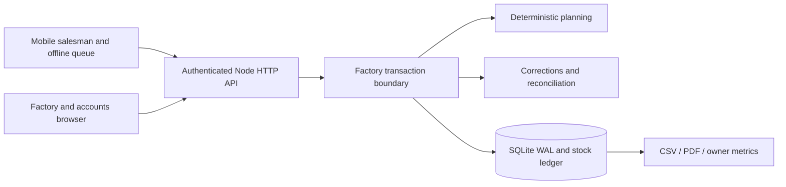
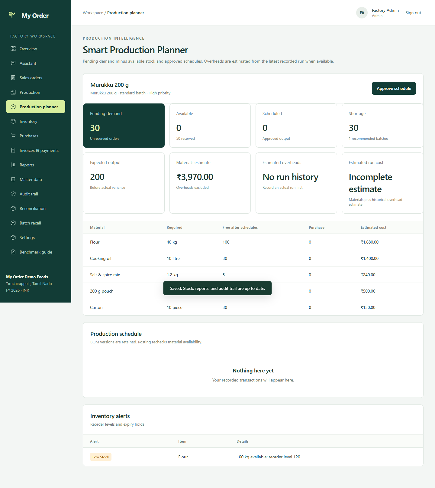
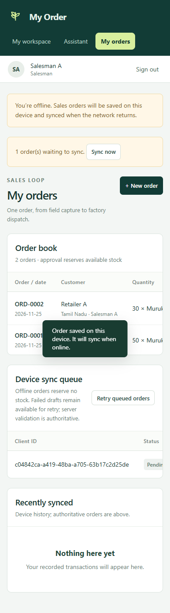

# My Order

A working food-factory prototype for the NIT Tiruchirappalli internship task. Mobile orders, production costs, stock, dispatch and collections share a source-linked ledger instead of separate spreadsheets.

## Run

Install **Node.js 24+**, open this directory and run:

```sh
npm start
```

Open http://localhost:3000. No runtime packages or build step are needed. Windows users can use `start.cmd`. First launch creates dummy masters/opening stock; later launches preserve transactions and apply additive migrations. The Node SQLite experimental warning is expected.

All demo accounts use **Demo@12345**:

| Username | Access |
|---|---|
| admin | Factory operations, approvals, dispatch, finance, masters, settings |
| production | Purchases, production, schedule execution, inventory, overheads |
| salesman.a | Retailer A and own orders |
| salesman.b | Distributor B and own orders |
| accountant | Read business records; collections, financial credits and refunds |
| auditor | Read-only business records and exports |
| owner | Read-only overview, planning, reconciliation and exports |

The old auditor login remains read-only; accountant is a separate identity. These are dummy demo credentials, not production secrets.

## Reproduce the benchmark

```sh
npm test
npm run benchmark
```

The benchmark posts the exact scenario to an isolated in-memory database, asserts results and prints JSON. Expected constants are assertions, never business-calculation inputs. To create a separate persistent demonstration:

```sh
node benchmark.js --database data/nit-benchmark.sqlite
```

The command refuses an existing path. To open it in PowerShell:

```powershell
$env:DB_PATH = 'data/nit-benchmark.sqlite'
npm start
```

`npm run seed` initializes the default opening dataset without clearing records. See the in-app Benchmark guide and [eight-minute script](docs/DEMO.md). The updated 6:49 demo recorded on 26 November 2026 shows the mandatory scenario and upgrade screens, including mobile orders, offline sync, planning, reconciliation and returns/refunds. See [video coverage](docs/VIDEO.md). The refreshed public video link is pending upload.

## Features

**Must-have:** scoped mobile ordering; server-side permissions; admin verification; atomic reservations; immutable invoice amounts/PDF; dispatch-only stock deduction; multiple products/pack sizes; versioned BOMs; actual consumption, output and variance; source ledger; auditor exports.

**Should-have:** weighted-average costing; frozen production issue values; labour, electricity, gas and other overheads; partial collections and ageing; date-filtered owner metrics; financial-year invoice numbering; discounts and configurable future GST/list prices; full credit notes; reconciliation; traceable adjustments/reversals.

**Stretch:** deterministic production recommendations and approved schedules; optional split approval with linked backorders; persistent offline drafts, retries and sync history; finished batch expiry/FEFO; physical return quarantine; customer recall traceability; reorder alerts; controlled refunds.

The planner uses `ceil(shortage / BOM output)`, subtracts existing schedules and counts reservations once. Material availability accounts for approved jobs and earlier recommendations. Schedules do not create stock or reserve materials: posting rechecks stock. Scheduled jobs retain their BOM version; new recommendations use the latest active version. Plans can be approved with shortages so purchases can be arranged.

## Architecture

Node's built-in HTTP server, SQLite WAL and buildless browser modules support a simple local start. `BEGIN IMMEDIATE` serializes writes; a five-second busy timeout handles competing connections. `Factory.act` commits source documents, movements, audit entries and idempotency results together.



[Architecture and ER diagrams](docs/ARCHITECTURE.md) · [API](API_DOCUMENTATION.md) · [Two-page design PDF](docs/DESIGN.pdf)

## Verified benchmark

| Metric | Expected | Actual |
|---|---:|---:|
| Flour / oil / spice closing | 120 kg / 19.5 L / 3.8 kg | 120 / 19.5 / 3.8 |
| Pouches / cartons | 306 / 21 | 306 / 21 |
| Finished after production / dispatch | 238 / 88 | 238 / 88 |
| Yield / oil variance | -6% / +5% | -6% / +5% |
| Taxable / CGST / SGST (INR) | 7500 / 187.50 / 187.50 | 7500 / 187.50 / 187.50 |
| Invoice / paid / outstanding (INR) | 7875 / 4000 / 3875 | 7875 / 4000 / 3875 |
| Distributor shortage | 32 packets | 32 packets |
| Materials / total run cost (INR) | 4055 / 5855 | 4055 / 5855 |
| Cost per good packet (INR) | About 31.14 | 31.14 |
| Reconciliation | No difference | Reconciled |

See [generated benchmark results](BENCHMARK_RESULTS.md).

## Costing, stock and financial decisions

Money is integer paisa; quantities are thousandths. BigInt intermediates and half-up rounding avoid binary floating-point posting errors. Supported conversions are g/kg, ml/litre and product-specific carton/packet; pieces and packets are whole.

Moving weighted average uses the value and quantity before an issue. New production issue values are frozen. Benchmark flour is `(100×42 + 60×45)/160 = INR43.125/kg`. Flour 1725 + oil 1470 + spice 240 + pouches 485 + cartons 135 = 4055; add labour 1200 and utilities 600, then divide 5855 by 188 = **31.143617...**. Damaged packaging is included once.

Overhead amendments retain quantities and audit before/after values. Operational finished-stock and dispatch valuation is replayed; there are no closed accounting periods. Failed runs require a reason, report their cost separately and create no finished inventory value.

`available = physical - held - reservations`. Approval reserves; invoice posting does not issue stock; dispatch does. Expired, undated and future-manufactured finished stock is held. Expiry-induced reservation deficits enter the planner. Default approval rejects a shortage; an explicitly selected split creates a linked backorder.

A full financial credit never increases stock. A separate physical return creates quarantined goods at recorded dispatch value. Refunds cannot exceed collected, unrefunded amounts. Adjustments require reasons and one-time linked reversals. Database triggers block ledger overwrites and changes to posted invoice/production amounts and quantities.

## Reports, security and verification

Seventeen report choices cover all fifteen requested categories plus combined stock and refunds. Dates and JSON/CSV/PDF are supported. Relevant entity filters select source documents; collection/receivable product filters select whole invoices rather than allocating payments across products. Reconciliation includes global exceptions. Stock, expiry and receivables are as-of reports.

Sessions use random opaque HttpOnly/SameSite cookies and eight-hour expiry. Salted scrypt passwords, backend authorization, bound SQL parameters, HTML escaping, CSP, same-origin writes, body limits, login throttling and idempotency are implemented. Missing sessions return 401; forbidden roles return 403. The optional existing assistant remains read-only and is never used for planning or costing. The example environment defaults to local lookup without a key.

[Test report](TEST_REPORT.md) records actual unit, integration, concurrency and browser results. Optional browser verification:

```sh
npm run test:browser
```

This requires Playwright and Chrome/Chromium in the test environment. Set `PLAYWRIGHT_MODULE` to an installed package path if needed and `BROWSER_EXECUTABLE` to a browser executable. Output is ignored under `test-artifacts/`. No browser dependency was added to the application runtime.




## Assumptions and limits

- GST 5%, dummy identities and Tamil Nadu factory state come from the exercise; no statutory filing or government validation is claimed.
- Opening 50 packets use an assumed INR25 value. Nine cartons are actual consumption for 188 good packets; eight packets can remain outside full cartons. Carton variance is reported.
- Dates use Asia/Kolkata. No backdating UI, closed periods or historical valuation revisions. Reclassifying unverified batches does not provide a complete temporal identity history.
- Raw materials are item-level, not supplier-lot-level. Recall shows recorded material quantities and affected customers, never invented lot provenance.
- Plans have no capacity optimization or material reservations. Overhead estimates use the latest completed run scaled to expected output; missing history is explicitly unknown.
- No WIP, sub-recipes, purchase-order approval workflow, partial returns/credits, full double-entry accounts, Tally, GST filing, Tamil UI or Unicode PDF fonts.
- Offline storage is unencrypted and sync requires the app to be open. Use dedicated demo devices and HTTPS/localhost; use dummy data only.
- Full ledger replay suits a small prototype. No large-volume performance claim is made.
- Public repository publication and the refreshed video link remain pending. No hosted deployment is claimed. Docker configuration is updated but was not run here.

[Deployment and security review](docs/DEPLOYMENT.md) · [Upgrade comparison and limitations](docs/UPGRADE_REVIEW.md) · [Thirty interview questions](docs/INTERVIEW.md)
