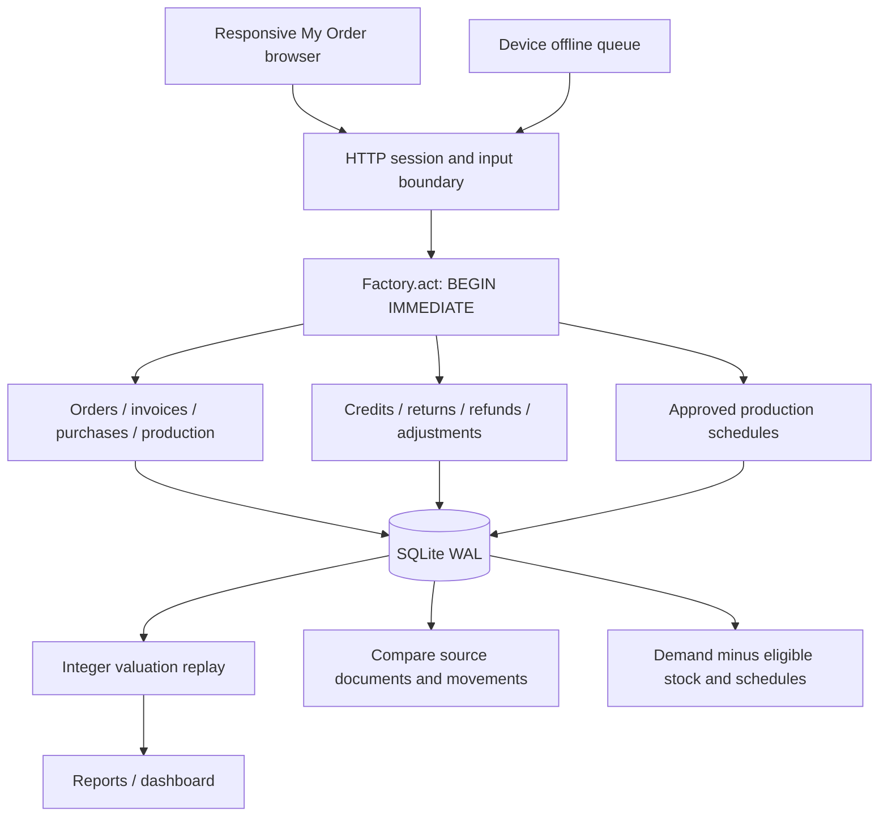
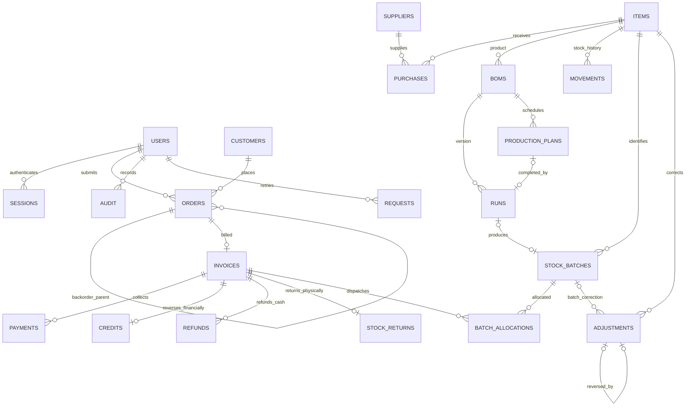

# Architecture and database relationships

Order/invoice lines and BOM/run components are validated JSON arrays with stable item IDs. `source`/`source_id` in movements is a polymorphic source reference, checked by reconciliation rather than a single SQL foreign key. Reservations are derived from approved/invoiced order lines inside the writer transaction: no second reservation balance can drift out of sync.

## Version 3 migration

`migrations.js` runs transactionally after the existing version-2 batch migration. It adds orders.parent_id; items.reorder_level; runs.gas/other; movements.posted_at/batch_id/frozen_value. It creates settings, production_plans, adjustments, stock_returns and refunds. Foreign keys, check constraints, unique invoice-return/refund-reference/reversal constraints, supporting indexes and immutability/negative-stock triggers protect new postings. Legacy movements retain an empty posting timestamp and use their original date/audit evidence; no historical timestamp is invented.

The old auditor identity changes from the legacy read-only `accountant` role to explicit `auditor`. A separate demo accountant is inserted once. No existing source documents, passwords or balances are reset. The automated migration test removes new schema elements, restores version 2, upgrades twice and compares posted balances.

The physical ledger is append-only. New material issue values are frozen at posting; old records still use chronological replay. Finished stock valuation is operational and changes when direct overheads are amended. No closed-period ledger is implied.
